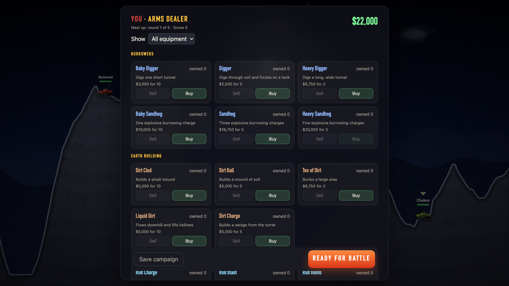
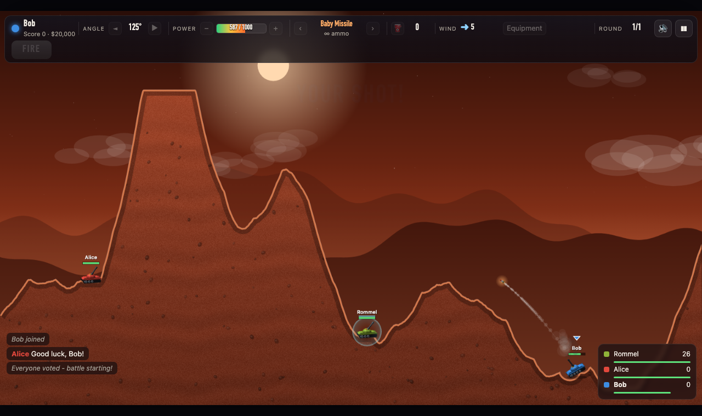

# Scorched Earth

**A browser artillery game about impossible shots, collapsing mountains, and spending your winnings on a bigger explosion.** Play solo, share the keyboard, or take a 2–10 commander battle online—all from the browser.

*Destructible worlds · ruthless robots · local and online multiplayer · zero npm dependencies*


## Fire. Survive. Rebuild your arsenal.

Every round drops the combatants onto a new procedural landscape. Read the wind, choose an angle and power, then watch the full ballistic arc play out. A direct hit can tear open the hillside, send a tank sliding into a crater, or trigger a chain reaction that changes the shot you were planning next.

Between rounds, damage and kills become cash. Spend it on smarter weapons, protection, repairs, parachutes, or enough fuel to crawl into a better firing position. Standard scoring rewards damage, kills, and survival. Greedy games rank commanders by net worth.

## What is in the game?

- **Three ways to play.** Battle adaptive AI, pass one screen between local players, or host online rooms with friends. You can even fill every seat with bots and watch the chaos unfold.
- **Choose when to fire.** Take turns, lock in a synchronous volley, or aim and fire in real time. Up to ten humans and bots can play campaigns of 1–1,000 rounds.
- **Fight alone or on a team.** Standard teams compete for victory. Corporate teammates draw from one treasury. In Vicious games, the last surviving team fights among itself.
- **33 weapons and 15 accessories.** Burrow through hills with Diggers, follow the slope with Rollers, fill hollows with Napalm, or split a Death’s Head above the battlefield. The arms dealer groups gear by family and shows its effect and DOS bundle price.
- **Terrain and defenses interact.** Soil can collapse or remain suspended over a tunnel. Shells can penetrate a thin ridge. Use contact triggers for surface impacts, guidance for a particular shot, or a magnetic or reflecting shield for defense.
- **Configurable battlefields.** Change gravity, air resistance, wind, walls, and environmental hazards. Random walls change each round. Erratic walls change with each shot.
- **Distinct computer opponents.** Choose an existing difficulty or a DOS personality. Poolshark banks shots, Tosser adjusts after misses, and Cyborg remembers attackers. Unknown conceals its chosen personality.
- **Between-round campaign saves.** Use **Save campaign** at the local arms dealer and **Resume campaign** on the title screen. One slot in this browser profile preserves the current shopper, purchases, market, teams, and next round.
- **A lively presentation.** Low-poly tanks and projectiles, animated trajectories, crater effects, five sky themes, a reactive HUD, and Web Audio sound effects make each shot land with impact.

## See the battlefield

<table>
  <tr>
    <td width="50%">
      
      <br /><strong>Build an arsenal between rounds</strong>
    </td>
    <td width="50%">
      
      <br /><strong>Host rooms, add bots, chat, and vote to start</strong>
    </td>
  </tr>
  <tr>
    <td colspan="2">
      
      <br /><strong>The same battle reaches every commander in real time</strong>
    </td>
  </tr>
</table>

## Play locally

Scorched Earth requires **Node.js 18 or newer**. There are no npm packages to install and no lockfile.

```sh
npm run build
npm start
```

Open [http://localhost:8080](http://localhost:8080), choose **Start local battle**, and configure 2–10 human or AI combatants. For an offline game, you can also open the generated `dist/index.html` directly after building.

The main screen shows the ten best human callsigns by final match score, with kills breaking ties. Local records are saved in your browser. The Online tab shows records shared by players on the selected game server.

### Controls

| Action | Keyboard | Mouse / touch |
| --- | --- | --- |
| Aim | `←` / `→` | Drag across the battlefield |
| Change power | `↑` / `↓` | Drag nearer or farther from the tank |
| Fine adjustment | Hold `Shift` while aiming or changing power | — |
| Choose weapon | `Q` / `E` / `Tab` | Weapon arrows in the HUD |
| Move | `F`, then `←` / `→`; `F` or `Esc` when done | Fuel and movement buttons |
| Restore 10 health | `R` | Battery in the HUD |
| Configure defenses and guidance | — | **Equipment** |
| Fire | `Space` or `Enter` | **FIRE** |
| Pause / help | `Esc` | Pause button |
| Chat online | `T` | Chat field |

For local real-time matches, open **Shared keyboard controls** in setup. Each human has six assignable keys for angle, power, weapon selection, and fire. In volley matches, each player locks in one shot before the shells launch together.

Tanks can use the full 0–1000 firing power range at any health.

Equipment prices, bundle sizes, and arms levels follow the DOS 1.5 tables. Blast radii and projectile speeds use this game's 1,536 × 864 world coordinates. [Scorched Earth 1.5 manual](https://www.abandonwaredos.com/docawd.php?idg=1912&sf=scorchedearthmanual.txt&sg=Scorched+Earth&st=manual)

## Take the battle online

Everyone visits the URL served by the same Scorched Earth server and chooses **Play online**.

1. Pick a callsign and create a room, join one from the lobby, or enter its four-letter code.
2. Share the generated invite link. The host assigns teams, adds AI commanders, and sets the match rules and turn timer.
3. Every seated player votes to start, shops in parallel when funds are available, and enters the same server-authoritative battle.
4. Use `T` to talk during the match. After the final standings, the room resets for a rematch vote.

Online play is designed to survive ordinary interruptions:

- A reload or dropped connection automatically restores control to the same player.
- A disconnected tank switches to autopilot until its commander returns.
- Late arrivals can spectate the live battle and take a seat in the next game.
- Turn timers fire automatically when time expires, so abandoned turns cannot stall the room.

To bind a different interface or port:

```sh
PORT=3000 HOST=127.0.0.1 npm start
```

For internet hosting, hardened Docker and Compose files, reverse-proxy examples, health checks, and a GHCR release workflow are included. See the [production runbook](CONTRIBUTING.md#production-compose).

## Scoring and strategy

The default is Standard scoring. Basic scores kills and survival. Greedy uses Standard points for income and ranks the match by cash plus equipment resale value. Each all-time leaderboard combines individual human scores across formats.

| Result | Standard score |
| --- | ---: |
| Deal damage | +1 per damage point |
| Destroy an opponent | +100 |
| Survive the round | +150 |
| Damage yourself | Penalty |

Campaigns start at $0 by default and go directly into the first round. Set starting cash in **Battlefield and economy** to shop before round one. Unspent cash earns 5% interest by default. The optional free market adjusts prices between shops for the rest of that campaign. Round performance earns money for the next visit to the arms dealer. The shop buys back complete bundles at 80% of their current price.

A few field lessons:

- Watch the wind indicator before copying the previous shot.
- Terrain is both cover and a weapon—remove the ground beneath a tank or build a mound in front of it.
- Repairing, moving, or switching targets may be better than forcing the same trajectory.
- Rubber walls enable bank shots; wrap-around walls let a shell leave one side of the battlefield and return from the other.
- Death explosions can set off chain reactions. Sometimes the safest target is not the closest one.

## Under the hood

The game is deliberately small and portable:

- A self-contained build bundles the browser game into one `dist/index.html` file.
- A fixed 120 Hz physics simulation drives projectiles, collisions, terrain damage, tank falls, and AI planning.
- Online matches use the same game engine on an authoritative Node server. Clients send inputs and render interpolated snapshots.
- Terrain snapshots include cavities and update changed columns. Reconnecting players and new spectators receive the whole field.
- The HTTP and WebSocket server uses Node built-ins only and includes origin checks, security headers, rate limits, ping keepalives, and reconnect support.
- The canvas renderer draws exported low-poly glTF models with flat shading, highlights, depth sorting, and a jointed tank barrel.

## Development

```sh
npm run build             # bundle src/ into dist/index.html
npm test                  # engine, AI, and multiplayer protocol suites
npm run test:release      # release metadata and container-tag policy
npm run test:browser      # local and two-browser Playwright flows
npm run validate          # standard release, build, Node, and browser checks
npm run models            # regenerate glTF exports and src/models.js
```

Browser tests save their own gameplay captures under `tests/shots/`. Model sources live in `models/`, browser modules in `src/`, and the zero-dependency HTTP/WebSocket server in `server/`. See [CONTRIBUTING.md](CONTRIBUTING.md) for validation, deployment, release, and rollback details.
