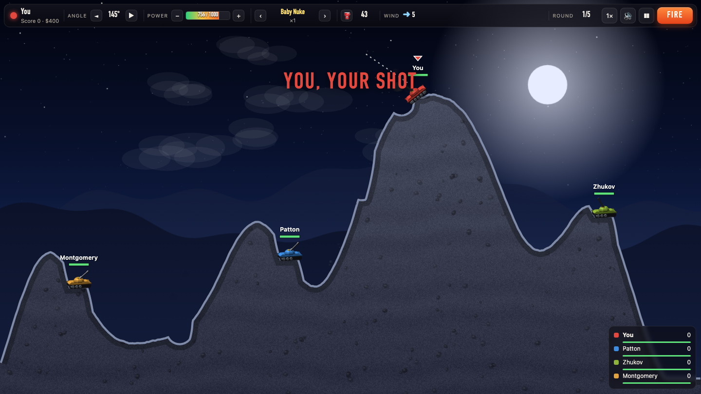
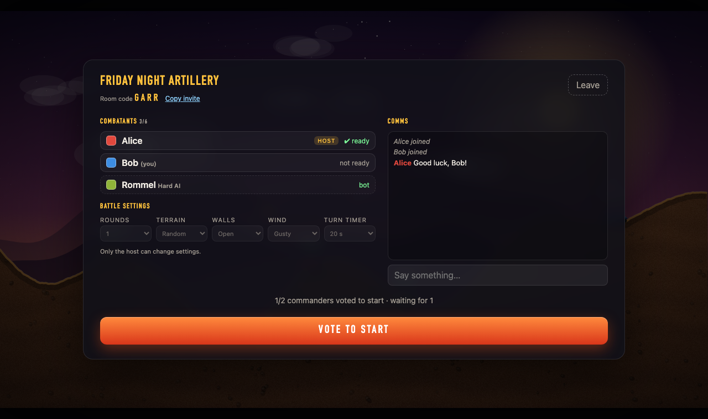

# Scorched Earth

**A turn-based artillery game about impossible shots, collapsing mountains, and spending your winnings on a bigger explosion.** Play solo, share the keyboard, or take a 2–6 commander battle online—all from the browser.

*Destructible worlds · ruthless robots · local and online multiplayer · zero npm dependencies*



## Fire. Survive. Rebuild your arsenal.

Every round drops the combatants onto a new procedural landscape. Read the wind, choose an angle and power, then watch the full ballistic arc play out. A direct hit can tear open the hillside, send a tank sliding into a crater, or trigger a chain reaction that changes the shot you were planning next.

Between rounds, damage and kills become cash. Spend it on smarter weapons, protection, repairs, parachutes, or enough fuel to crawl into a better firing position. The commander with the best total score—not merely the last tank standing—wins the war.

## What is in the game?

- **Three ways to play.** Battle adaptive AI, pass one screen between local players, or host online rooms with friends. You can even fill every seat with bots and watch the chaos unfold.
- **Fully destructible terrain.** Explosions carve persistent craters, displaced soil collapses, Dirt Balls build new cover, and Diggers tunnel through the landscape.
- **Ballistics that reward skill.** Gravity, power, gusting wind, terrain, and three wall modes—open sky, rubber walls, and wrap-around—make every shot a puzzle.
- **A dangerous arsenal.** Fire Missiles, bouncing Leapfrogs, five-warhead MIRVs, Baby Nukes, full-size Nukes, Dirt Balls, and Diggers. The Baby Missile is always available when the expensive ammunition runs out.
- **Movement and survival gear.** Buy fuel to reposition on terrain-aware slopes, shields to absorb damage, repair kits to get back in the fight, and parachutes to survive sudden drops.
- **AI that learns your range.** Four difficulty levels use the same physics as the player. Stronger opponents account for wind, bracket their shots, choose safer weapons, and spend their cash more intelligently.
- **A complete campaign loop.** Configure the battlefield, shop, fight across multiple rounds, earn money from performance, and chase the final standings.
- **A lively presentation.** Low-poly tanks and projectiles, animated trajectories, crater effects, five sky themes, a reactive HUD, and Web Audio sound effects make each shot land with impact.

## See the battlefield

<table>
  <tr>
    <td width="50%">
      
      <br /><strong>Build an arsenal between rounds</strong>
    </td>
    <td width="50%">
      
      <br /><strong>Host rooms, add bots, chat, and vote to start</strong>
    </td>
  </tr>
  <tr>
    <td colspan="2">
      
      <br /><strong>The same battle reaches every commander in real time</strong>
    </td>
  </tr>
</table>

## Play locally

Scorched Earth requires **Node.js 18 or newer**. There are no npm packages to install and no lockfile.

```sh
npm run build
npm start
```

Open [http://localhost:8080](http://localhost:8080), choose **Start local battle**, and configure 2–6 human or AI combatants. For an offline game, you can also open the generated `dist/index.html` directly after building.

### Controls

| Action | Keyboard | Mouse / touch |
| --- | --- | --- |
| Aim | `←` / `→` | Drag across the battlefield |
| Change power | `↑` / `↓` | Drag nearer or farther from the tank |
| Fine adjustment | Hold `Shift` while aiming or changing power | — |
| Choose weapon | `Q` / `E` / `Tab` | Weapon arrows in the HUD |
| Move | `F`, then `←` / `→`; `F` or `Esc` when done | Fuel and movement buttons |
| Repair | `R` | Repair item in the HUD |
| Fire | `Space` or `Enter` | **FIRE** |
| Pause / help | `Esc` | Pause button |
| Chat online | `T` | Chat field |

Wind affects every shell. Damage also limits a tank's maximum firing power, so a wounded commander may need to move closer or rethink the shot.

## Take the battle online

Everyone visits the URL served by the same Scorched Earth server and chooses **Play online**.

1. Pick a callsign and create a room, join one from the lobby, or enter its four-letter code.
2. Share the generated invite link. The host can add AI commanders and set the rounds, terrain, walls, wind, and turn timer.
3. Every seated player votes to start, shops in parallel, and enters the same server-authoritative battle.
4. Use `T` to talk during the match. After the final standings, the room resets for a rematch vote.

Online play is designed to survive ordinary interruptions:

- A reload or dropped connection automatically restores control to the same player.
- A disconnected tank switches to autopilot until its commander returns.
- Late arrivals can spectate the live battle and take a seat in the next game.
- Turn timers fire automatically when time expires, so abandoned turns cannot stall the room.

To bind a different interface or port:

```sh
PORT=3000 HOST=127.0.0.1 npm start
```

For internet hosting, hardened Docker and Compose files, reverse-proxy examples, health checks, and a GHCR release workflow are included. See the [production runbook](CONTRIBUTING.md#production-compose).

## Scoring and strategy

| Result | Score |
| --- | ---: |
| Deal damage | +1 per damage point |
| Destroy an opponent | +100 |
| Survive the round | +150 |
| Damage yourself | Penalty |

Round performance earns money for the next visit to the arms dealer. Ammunition can also be sold back at 80% of its purchase price, which makes changing strategy between rounds a viable move.

A few field lessons:

- Watch the wind indicator before copying the previous shot.
- Terrain is both cover and a weapon—remove the ground beneath a tank or build a mound in front of it.
- Damaged tanks lose maximum power. Repairing, moving, or switching targets may be better than forcing the same trajectory.
- Rubber walls enable bank shots; wrap-around walls let a shell leave one side of the battlefield and return from the other.
- Death explosions can set off chain reactions. Sometimes the safest target is not the closest one.

## Under the hood

The game is deliberately small and portable:

- A self-contained build bundles the browser game into one `dist/index.html` file.
- A fixed 120 Hz physics simulation drives projectiles, collisions, terrain damage, tank falls, and AI planning.
- Online matches use the same game engine on an authoritative Node server. Clients send inputs and render interpolated snapshots.
- The HTTP and WebSocket server uses Node built-ins only and includes origin checks, security headers, rate limits, ping keepalives, and reconnect support.
- The canvas renderer draws exported low-poly glTF models with flat shading, highlights, depth sorting, and a jointed tank barrel.

## Development

```sh
npm run build             # bundle src/ into dist/index.html
npm test                  # engine, AI, and multiplayer protocol suites
npm run test:release      # release metadata and container-tag policy
npm run test:browser      # local and two-browser Playwright flows
npm run validate          # standard release, build, Node, and browser checks
npm run models            # regenerate glTF exports and src/models.js
```

Browser tests save their own gameplay captures under `tests/shots/`. Model sources live in `models/`, browser modules in `src/`, and the zero-dependency HTTP/WebSocket server in `server/`. See [CONTRIBUTING.md](CONTRIBUTING.md) for validation, deployment, release, and rollback details.
